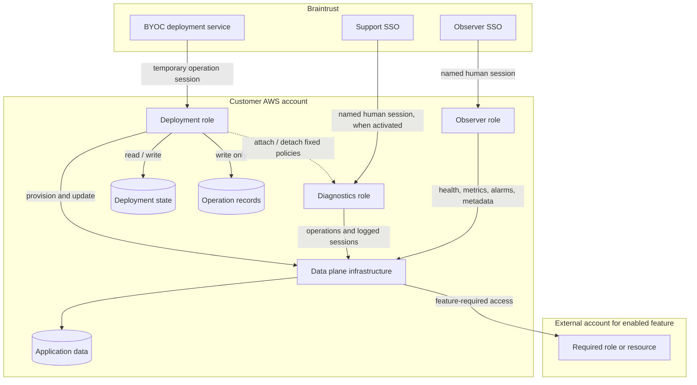

# AWS managed BYOC access model

Status: design preview. Live access and logging acceptance remain pending.

This package describes Braintrust's standard AWS roles and customer controls
for managed BYOC. It is a security review reference, not an installable bootstrap.
We welcome feedback that improves the standard model.

Braintrust operates the data plane; the customer owns the AWS account,
bootstrap, state, and audit destinations. The account must be dedicated to
Braintrust infrastructure. It may contain multiple data planes, and each data
plane may serve multiple teams. Unrelated workloads belong in other accounts.

## Start here

| To review | Read |
| --- | --- |
| Role capabilities and trust limits | This page |
| Policy attachments, IAM delegation, names, and inputs | [Policy guide](policies/README.md) |
| Principals, session attribution, and trust | [Trust guide](trust-policies/README.md) |
| Organization controls | [Guardrail guide](guardrails/README.md) |
| Temporary operational access | [Diagnostics guide](diagnostics.md) |
| Audit collection and detections | [Monitoring guide](guardrails/cloudtrail-alerting.md) |

No deployment or placeholder substitution is needed to review these files.

## Roles and access

| Role | Purpose | Access |
| --- | --- | --- |
| `BraintrustDeploymentRole` | Automated infrastructure lifecycle | Privileged infrastructure management, deployment state, module secrets, and service configuration |
| `BraintrustObserverRole` | Standing human inspection | Infrastructure health, metrics, alarms, and metadata; no application content or sensitive workload configuration |
| `BraintrustDiagnosticsRole` | Temporary human operations and troubleshooting | Operational changes, application logs, sensitive configuration, and host/container sessions when activated |

Each role trusts an exact designated Braintrust principal. Deployment uses a
bootstrap-specific execution role and unique External ID. Human sessions carry
the individual engineer's source identity. See the [trust guide](trust-policies/README.md).

### Effective access

| Capability | Deployment | Observer | Activated Diagnostics |
| --- | --- | --- | --- |
| Infrastructure health, metrics, alarms, and metadata | Yes | Yes | Yes |
| Deployment state | Exact state prefix | No | No direct grant |
| Secret values | License and prefixed module secrets | No | Through workloads; no direct Secrets Manager grant |
| Sensitive workload configuration | Yes | No | Yes |
| Application S3 objects or database rows | No direct content grant beyond state/artifacts | No | Through workload access |
| CloudWatch application log events | No direct grant | No | Matching application groups |
| Other service content | EC2 console output, RDS logs, and SQS messages under broad lifecycle grants | No | Through permitted configuration, logs, and workloads |
| Host/container sessions | No interactive grant | No | Managed Brainstore SSM shells and ECS Exec |
| Infrastructure changes | Lifecycle management | No | Scoped scaling, recovery, concurrency, schedules, and database tuning |
| Runtime IAM management | Prefixed resources with the required boundary and limited `PassRole` | No | No |
| Bootstrap IAM changes | Two fixed Diagnostics attachments only | No | No |
| Deletion of SCP-protected buckets, keys, and final snapshots | Blocked for the listed actions | Blocked | Blocked |

The [JSON policies](policies/README.md#role-attachment-model) are the exact
permission reference. Some lifecycle, configuration, and discovery grants apply
across the account and Regions; a resource prefix is not complete isolation
between data planes.
These capabilities assume no additional identity or resource-policy grants.

## Temporary Diagnostics

Diagnostics has no policies attached when inactive. Activation attaches shared
inspection and the predefined Diagnostics policy to the exact role. One window
covers all data planes under the bootstrap and multiple named engineers. The
default window is two hours; extensions are explicit and recorded.

Braintrust handles activation and records the applicable customer approval,
including standing approval where it covers the work. This is a process control,
not an approval gate that Braintrust is technically unable to bypass.

Activated access can read or modify customer data and can include root access.
Application logs and workload configuration may expose data even without a shell.
The supported interactive paths are logged Session Manager shells and ECS Exec,
not SSH or port forwarding.

Closure removes both policies and terminates associated sessions. Incomplete
cleanup remains pending until verified. Customers can remove Braintrust trust
at any time; this blocks new assumptions but does not alone end existing
credentials or connections. See [activation and revocation](diagnostics.md).

## Customer controls and responsibilities

| Braintrust | Customer |
| --- | --- |
| Provides the bootstrap and operates deployment, upgrades, and Diagnostics | Applies the bootstrap in a dedicated AWS member account |
| Configures SSM/ECS transcript collection and verifies prerequisites before Diagnostics | Enables account-level S3 Block Public Access and applies organization safeguards |
| Records operation intent, authorization, results, and cleanup | Owns CloudTrail, alerting, recovery access, and optional separate audit archival |

The [reference SCP](guardrails/README.md) protects selected account security
controls, retained resources, and snapshot sharing. It applies to customer
administrators too. Protected maintenance requires an organization administrator
to amend the policy and restore the baseline. Existing organization policies
may provide equivalent validated protections; the customer uses its normal
policy deployment process.

CloudTrail records configured AWS API activity; CloudWatch stores diagnostic
transcripts; operation records describe deployment and access workflows. These
records remain customer-owned. The [monitoring guide](guardrails/cloudtrail-alerting.md)
shows the destinations, recommended detections, and optional archive replication.

## IAM delegation and permission changes

Deployment manages runtime roles and policies under a reserved name prefix.
Created roles must carry the customer-owned runtime permissions boundary.
`PassRole` is limited to matching roles and listed AWS services. Module policies
grant each workload its actual permissions; the boundary grants none by itself.
Listed service-linked roles are an AWS-managed exception.

Deployment cannot rewrite its bootstrap policies or trust. Its only bootstrap
IAM change is attaching or detaching the two fixed Diagnostics policies.
New lifecycle services or features can require versioned bootstrap or boundary
updates controlled by the customer. Updating the data-plane module does not
automatically update those permissions.

See the [attachment map and naming rules](policies/README.md) for exact scope.

## Access outside the BYOC account

Enabled features can require access to an exact external role or resource.
For example, the Gateway may assume a role to use Bedrock in another account;
S3 export may write to a designated bucket in another account.

Each feature has documented source, destination, permissions, and configuration
requirements. Customers configure that access to use the feature; otherwise it
remains unavailable. This is a product requirement, not a separate approval for
each operation.

The base runtime boundary permits only the API handler's internal quarantine
and AI Proxy role assumptions. External integrations require matching workload,
boundary, and destination permissions. This package does not provide a universal
cross-account perimeter. See [external feature requirements](policies/README.md#external-feature-requirements).

## Data retention and important limits

Customer deprovisioning uses `retain-data`: serving infrastructure is removed,
while the module-owned Brainstore storage, data-plane key and alias, and final
RDS snapshot remain for customer recovery or deletion. State and operation
records also remain customer-owned. A partial deployment may have no database
and therefore no final snapshot.

Understand these boundaries:

- **Privileged deployment:** automation can change workload code, runtime trust,
  and bucket/key policies. Removing direct content grants does not prove that
  Braintrust cannot reach data through workloads or resource-policy changes.
- **Sensitive state:** deployment state can contain generated credentials and
  application encryption material. Deployment can read it; human roles have no
  direct state grant.
- **Retention is not immutability:** the SCP blocks specified bucket, key, and
  snapshot deletions. It does not block object deletion or unsafe lifecycle
  expiration. Workloads and privileged diagnostic sessions can modify data.
- **Logging has limits:** Deployment can change ECS Exec logging settings, and
  a privileged shell can interfere with capture. Activation checks, monitoring,
  and customer-controlled archival reduce risk but do not guarantee a complete
  transcript of every action.
- **Session removal must be verified:** an expired window or detached policy is
  not proof that every connection ended.

These are the trust boundaries of a managed service, not guarantees of complete
data isolation from its operator.

## Implementation reference

[contract.json](contract.json) records the package revision, export inventory,
and policy digests. [Policy inputs](policies/README.md#inputs) and
[trust inputs](trust-policies/README.md) document exact identifiers and limits.
Static validation is not live access acceptance. The production bootstrap must
implement and validate the selected revision before use.

## Preview change history

This table records changes to the customer review package, not changes
deployed to any AWS account. New entries appear first.

| Date | Change | What to review |
| --- | --- | --- |
| 2026-11-04 | Removed unused VPN, edge hardware, specialized compute, VM import/export, legacy EC2 metadata, DynamoDB, and EFS reads from shared inspection. | Observer and activated Diagnostics retain data-plane inspection, networking, capacity, quotas, and EKS metadata. Deployment and SCP permissions are unchanged by this cleanup. |
| 2026-11-04 | Consolidated organization guardrails into one account-wide SCP and narrowed inspection and ECS lifecycle grants to preserve the three-role model. Simplified the guides and generated handoff. | Review account-wide effects, Deployment's service-content access, retained-data limits, and monitoring. This is a new bootstrap revision, not an update to existing permissions. |
| 2026-10-29 | Scoped account and organization administration restrictions to Braintrust management and workload roles, consistent with the other safeguards. | Customer administrators outside the reserved IAM namespaces retain control of account settings. Braintrust still cannot change account-level S3 public access protection or organization controls. |
| 2026-10-28 | Improved navigation and added a deployment policy file map. Clarified that management roles have no permissions boundary; the boundary applies to workload roles. | Documentation only; permissions and the contract revision are unchanged. |
| 2026-10-28 | Simplified to Deployment, Observer, and temporary Diagnostics. Combined operational and diagnostic permissions, added selected tag reads and Diagnostics IAM inspection, and removed redundant denials. Generalized customer package naming. | Review the three-role access matrix, two-policy activation and revocation, and required customer safeguards. Issued definitions remain unchanged; live acceptance of this revision is pending. |
| 2026-10-06 | Revision `preview.7` corrects protected EC2 shell authorization and adds bounded ECS initiating-actor correlation. | Original RoleId still scopes SSM cleanup. ECS termination is target-tag scoped and the coordinator verifies its CloudTrail actor. Regional event-history read is new; prior issuance is unchanged. Live acceptance remains required. |
| 2026-10-06 | Revision `preview.6` allows the two deployment hooks at their exact `$LATEST` qualifiers, matching Terraform invocation. | Positive permissions and retained-data guardrails match. No other functions, aliases, versions, retention permissions or human access are added; prior issuance is unchanged. |
| 2026-10-05 | Revision `preview.2` requires default AWS-managed license encryption and removes the license KMS input/grant. Added read-only bucket-encryption and bootstrap inline-policy metadata checks for readiness. | Review Secrets Manager service/context restrictions and the two read-only IAM guardrail exceptions; retention and human permissions are unchanged. |
| 2026-10-05 | Revision `preview.3` adds metadata reads for the exact protected Session Manager document and agent readiness. | Supports logging verification before temporary Diagnostics activation. Prior issued revisions remain immutable; no new human or data access is granted. |
| 2026-10-06 | Revision `preview.4` separates machine role assumption from STS session-attribute permissions. | Retains the exact principal, unique External ID on assumption and required operation source identity. Corrects a role-chaining denial found during live acceptance; prior issuance is not changed. |
| 2026-10-06 | Revision `preview.5` adds `rds.amazonaws.com` to the runtime-role PassRole service allowlist and matching retained-data guardrail. | Permits RDS to accept the deployment's enhanced-monitoring role. The role trust remains `monitoring.rds.amazonaws.com`; runtime role namespace and retention restrictions are unchanged. Prior issued definitions are preserved. |
| 2026-10-05 | Established a revisioned, self-contained customer contract and explicit retention-only mode contract. IAM, trust, and SCP JSON are unchanged from the reviewed source. | Review the profile and revision record; implementation and live acceptance remain pending. |
| 2026-10-02 | Removed the detailed Kubernetes permission guide and RBAC reference from the customer review package. | Documentation only; AWS IAM policies and guardrails are unchanged. |
| 2026-10-02 | Simplified identity policies and the runtime boundary to positive allowances; moved explicit restrictions into the three customer SCPs. Layered activated Diagnostics on shared inspection and Support, with exact attachment controls for all three policies. Expanded selected metadata read families and limited Lambda deployment grants to infrastructure operations. | Review the attachment map, required SCP coverage for management and runtime roles, and feature updates to both the runtime boundary and SCPs. Trust, diagnostic targets, retention, and Deployment's ECS cluster management are preserved. |
| 2026-10-01 | Replaced Deployment's permissions boundary with a protected identity guardrail policy. Preserved its explicit restrictions and made role and service limits explicit denials. Runtime boundaries, human policies, trust, and SCPs are unchanged. | Review the updated attachment map and guardrail policy, including `PassRole`, service-linked role creation, and protection against changing or detaching the guardrail. |
| 2026-09-30 | Improved reading order and navigation, clarified review and implementation responsibilities, and reorganized the policy and guardrail guides. No policies changed. | Use the Start here links and role attachment map; permissions, safeguards, and scope are unchanged. |
| 2026-09-30 | Consolidated deployment log-routing and interactive-access denials into one SCP statement. No permissions changed. | The actions, principal, and conditions remain identical; the policy document is smaller. |
| 2026-09-30 | Added deployment ownership-control permissions for module-created S3 VPC flow-log destinations. | The two actions remain scoped to the managed bucket prefix; public access protection and object permissions are unchanged. |
| 2026-09-30 | Denied runtime changes to bucket policies, bucket ACLs, and bucket public access settings. Removed the unused deployment bucket ACL grant. | Review the separation between workload object access and deployment bucket administration; object permissions and presigned URLs are unchanged. |
| 2026-09-30 | Protected account-level S3 Block Public Access and documented enabling it before the SCP. Combined equivalent IAM prefix denials to preserve policy space without changing their restrictions. | Review the account-wide public access safeguard, continued support for authorized presigned URLs, and unchanged deployment bucket permissions. |
| 2026-09-30 | Required legacy support options to remain disabled, denied workload-initiated interactive access and management-role transcript writes, and added Loop MicroVM log scope. Preserved Deployment's ECS cluster updates and documented required logging checks. Clarified naming and privileged deployment access. | Review separation of routine and activated access, transcript writers, deployment-managed ECS logging, and the limits of direct data access restrictions. |
| 2026-09-30 | Distinguished SSM and ECS Exec transcript sources and labeled CloudWatch log groups explicitly. Added optional customer-managed replication to a separate audit archive account. No permissions changed. | Review local collection as the default and separate archival as a recommended customer control. |
| 2026-09-30 | Added a logging diagram distinguishing CloudTrail API events, diagnostic transcripts, and operation records. Clarified storage ownership and the limits of logging protections. No permissions changed in this update. | Review the evidence destinations, configuration responsibilities, and distinction between protected audit resources and ordinary application logs. |
| 2026-09-29 | Corrected internal runtime role assumptions; closed log-derived content paths and routine human role chaining; allowed bootstrap IAM inspection without weakening mutation controls. Standardized naming, added S3 ABAC and EKS access-entry tagging permissions, and strengthened rendered-policy checks. | Review the internal invocation exceptions, mandatory IAM paths and naming limits, regional scope, and unchanged separation between routine and activated Diagnostics access. |
| 2026-09-29 | Added temporary Diagnostics access, exact activation permissions, and dedicated session logging safeguards. Added scoped EKS management and discovery permissions plus future Kubernetes role profiles. | Review data-capable troubleshooting, activation and logging controls, and the distinction between proposed Kubernetes permissions and an implemented access path. |
| 2026-09-25 | Extended the bootstrap scope to multiple data planes under one reserved prefix; protected retained keys without a post-creation key ARN; removed unused broad deployment grants and denied CloudWatch Logs routing/export. Clarified equivalent customer controls and the role-wide permission ceiling. | Review naming scope, KMS and retained-data safeguards, log routing restrictions, and the distinction between role access and per-operation credentials. |
| 2026-09-23 | Simplified the access diagram and human operations summary; clarified that external access is a documented feature requirement, not a case-by-case approval. No permissions changed. | Role access and operating boundaries are unchanged. |
| 2026-09-23 | Added the external access model, an S3 owner-account guardrail for Braintrust roles, exact artifact bucket scope, default-deny runtime role assumption, and cross-account audit guidance. | Review the boundary between routine BYOC operations and explicitly enabled runtime integrations. |
| 2026-09-17 | Published the initial AWS BYOC role, policy, and customer guardrail preview. | Baseline for subsequent feedback. |
