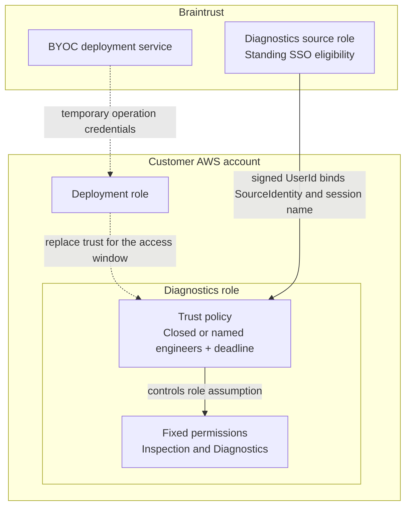

# Temporary Diagnostics access

[Back to overview](README.md#start-here)

Status: design preview; live access and transcript acceptance remain pending.

Diagnostics provides temporary operational and troubleshooting access.
It can read or modify customer data and may provide root access on managed
hosts or inside containers. Logs and configuration may expose sensitive
content even without a shell.

## Activation and closure

- Bootstrap attaches inspection and the predefined
  [Diagnostics policy](policies/README.md#role-attachment-model), with
  [closed trust](trust-policies/diagnostics-role-trust-policy.json).
- Braintrust's deployment service uses the customer Deployment role to replace
  that trust with a [temporary grant](trust-policies/diagnostics-active-trust-policy.json):
  the exact Braintrust Diagnostics source role, named engineers' verified IAM
  Identity Center UserIds, and an absolute expiry. It does not change SSO
  assignments or the Diagnostics permissions policies.
- One activation covers all data planes under the bootstrap. Only named
  participants may assume Diagnostics during the window; eligibility for the
  shared Braintrust source role alone is not enough.
- Braintrust records the authorizing actor, named participants, reason, scope,
  approval reference, start, expiry, extensions, and closure result. The default
  window is two hours; chained AWS credentials last at most one hour.
- Activation verifies logging and delivers its operation record before opening
  trust, then reads back the resulting policy. The participant list stays fixed;
  changing it requires closure and a new activation. Extensions require fresh
  verification, evidence, and readback. Failed updates remain visible.
- At the deadline, the trust condition blocks new assumptions even if the
  deployment service is unavailable. Early closure restores closed trust;
  expiry also schedules restoration of that baseline. Failed restoration stays
  visible and retryable, without extending the expired grant.

The customer can inspect the source role, permitted UserIds, and
deadline in its own IAM console or API. CloudTrail records trust changes and
successful role assumptions. The inactive, customer-disabled, and active examples
are alternative complete trust documents, not statements to combine.

Braintrust handles activation. A recorded customer approval or applicable
standing approval is required. This is process approval, not a customer-owned
technical gate that Braintrust cannot bypass while activation is enabled.
The separate customer disable control is described below.

Deployment's `iam:UpdateAssumeRolePolicy` is limited to the exact Diagnostics
role and a service-issued activation/close capability, but AWS does not constrain
the replacement document to the example's participants or deadline. Braintrust's
activation workflow must enforce those rules. Fixed permissions and customer
guardrails still limit the assumed role.

Trust requires the signed `identitystore:UserId` and binds both requested
SourceIdentity and the customer role-session name to that value. The engineer
cannot choose another participant's identity or session name. An inherited
SourceIdentity is not required from the login path; a caller-selected string
without the signed identity context is insufficient. See the
[trust guide](trust-policies/README.md) for the exact conditions.

Do not add alternative assumption grants or independent session permissions
through resource policies; these can bypass the intended access path.

## Customer-owned disable control

The issued bootstrap's CloudFormation parameter `DiagnosticsActivationEnabled`
defaults to `true`. This permits activation while trust remains inactive; it
does not grant standing customer access.

To disable the route, the customer updates the same bootstrap stack, using its
original template, with that parameter set to `false`. Bootstrap installs
[`CustomerDiagnosticsActivationControl`](policies/customer-disable-policy.json)
as an inline explicit deny on Deployment and resets Diagnostics trust to
[customer-disabled](trust-policies/diagnostics-disabled-trust-policy.json).
The deny is written before trust reset. Disabled and inactive documents have
different statement IDs so the parameter change resets an externally activated
trust policy. Wait for successful stack completion and verify both actual states;
an incomplete update is not proof of closure.

Keep activation disabled until the current grant has closed and its operation
records have been delivered. Do not race re-enable with an in-flight activation
or incomplete stack update. Re-enable resets trust to inactive and requires a
fresh activation. The issued bootstrap package provides its exact customer
commands; these review JSON files are not an installable stack.

Deployment cannot directly remove its protected inline policy, change the fixed
Diagnostics permissions, or mutate the owning bootstrap stack. Stack protection
uses the actual `AWS::StackId`, independent of naming. A deny attached to
Deployment does not constrain another privileged CloudFormation service role or
Lambda that it could indirectly use. Review reserved resource ownership and
those delegated privileges before relying on this control. Deployment remains
a privileged workload-management path.

## Expiry and existing sessions

The unchanged absolute expiry stops new assumptions without an IAM update.
Grant, extension, and early-close updates take time to propagate to STS; policy
readback confirms the stored document, not immediate enforcement everywhere.
An extension issued near the previous deadline can therefore leave a temporary
access gap, and early closure is not an immediate cutoff.

Trust expiry or effective closure does not invalidate credentials already issued.
Those credentials can authorize new API calls and shell connections until their
own expiry. An established shell can continue beyond credential expiry.
Routine closure does not revoke AWS sessions or terminate connections.

Configure the logged SSM document with a 60-minute maximum session duration and
20-minute idle timeout. ECS Exec has a fixed 20-minute idle timeout, not an
absolute maximum duration. A two-hour activation window is therefore not a
two-hour maximum for all ongoing access. Emergency revocation is separate.

## Permitted access

| Path | Scope |
| --- | --- |
| Session Manager shell | Instances with matching `BraintrustDeploymentName` and recognized `BrainstoreRole` tags; exact logged shell document |
| ECS Exec | Clusters and tasks under the managed prefix |
| Application logs | Matching `/braintrust/`, `/ecs/`, `/aws/lambda/`, and Loop MicroVM groups |
| Workload configuration | Task definitions, user data, and launch configurations |
| Operational changes | Scoped scaling, task recovery, Lambda concurrency, module schedules, database/cache reboot, and database parameter tuning |

Some configuration and discovery reads apply across the account and Regions;
the managed prefix is not complete isolation between data planes.

We use standard Session Manager shells, not SSH or port forwarding. The role
does not grant generic Run Command, EC2 Instance Connect, IAM administration,
outbound role assumption, or direct state/object/secret/database API reads.
Workload credentials and shell access can still reach and modify data.

ECS Exec traffic uses the module's KMS key. The Diagnostics grant for
`kms:GenerateDataKey` supports that session transport, not direct decryption.

## Logging requirements and limits

Bootstrap creates:

- Session document `BraintrustDiagnosticsShell-<BOOTSTRAP_NAME>`, using
  `Standard_Stream` and CloudWatch streaming with no caller-controlled
  logging destination or session type.
- Log group `/braintrust-byoc/<BOOTSTRAP_NAME>/diagnostics`, with 90-day
  retention and default CloudWatch encryption. No additional transcript KMS
  key is required.

The module must enable SSM/ECS Exec and provide instance/task transcript-write
permissions. ECS logging must use `OVERRIDE` to this group, with images and
network access that support capture. IAM JSON alone does not configure delivery.

Deployment retains ECS cluster management, including Exec logging settings.
Activation verifies the destination and configuration. Missing logging blocks
activation; unexpected drift triggers investigation and closes trust to new
assumptions. Existing sessions are subject to the limits above.

CloudTrail records AWS API activity; CloudWatch holds command/output transcripts.
Management roles have no direct transcript-write grant. Workloads deliver
transcripts, and a privileged shell can interfere with capture or use workload
credentials. Logging does not guarantee a complete record of every action.

See the [logging diagram and monitoring guide](guardrails/cloudtrail-alerting.md)
for customer-owned destinations and optional separate archival.

## Customer revocation

To end access, the customer can use its normal AWS administration process to:

1. Set `DiagnosticsActivationEnabled=false` as described above and verify the
   protected deny and reset trust. Removing Diagnostics trust alone is reversible
   by Deployment. For a broader operator cutoff, independently restrict or
   revoke Deployment access too, including issued sessions as appropriate.
2. For an emergency, independently revoke issued Diagnostics role sessions and
   terminate active Session Manager and ECS Exec connections. These actions go
   beyond routine closure; evaluate and verify each affected access path.
3. Confirm the resulting state with independent customer recovery access and
   account for the privileged indirect paths described above.

Revocation procedures must account for IAM propagation and active connections.
Changing a role's trust policy does not by itself control who may edit that policy.

References: [SSM access](https://docs.aws.amazon.com/systems-manager/latest/userguide/getting-started-restrict-access-examples.html),
[ECS Exec](https://docs.aws.amazon.com/AmazonECS/latest/developerguide/ecs-exec.html),
[role session revocation](https://docs.aws.amazon.com/IAM/latest/UserGuide/id_roles_use_revoke-sessions.html).
