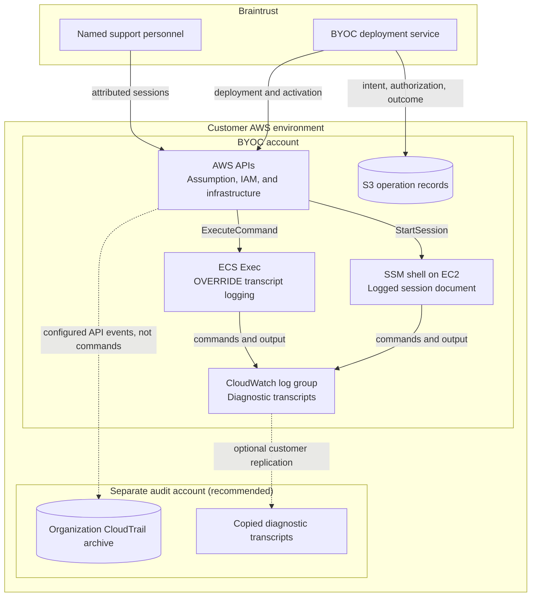

# AWS security monitoring

[Back to overview](../README.md#start-here)

Use the customer's existing CloudTrail and security monitoring where available.
Braintrust operates the data plane; the customer controls organization safeguards,
audit collection, alerts, and recovery access outside Braintrust's trust chain.

## Collection

- Collect read and write management events across deployed Regions.
  An organization trail delivered to a separate audit account is recommended.
- Enable targeted data events where a detection needs them, including object
  access to state/operation buckets and unexpected management-role access to
  application storage. S3 object reads, Lambda invocations, and message/record
  access are not covered by management events alone.
- Scope selectors before ingestion. Do not enable all workload data events
  unless needed for a detection or compliance requirement; volume can be high.
- For enabled external integrations, collect the destination role's activity
  and relevant data events in that account too.
- Preserve role ARN, session name, SourceIdentity, event ID/time, source IP,
  request parameters, result, and error code. Evaluate successful and denied
  requests; services use different denial codes and logging paths.

CloudTrail captures supported activity selected by that configuration, not every
API call. Validate the required allowed and denied events before relying on alerts.
Existing GuardDuty, Config, Security Hub, and Access Analyzer coverage can
complement these detections; a new monitoring stack is not required.

## Recommended detections

Scope signals to the BYOC account, bootstrap resources, and named roles.
An API name alone is not evidence of an unsafe change; inspect request parameters.

| Priority | Signal | Evaluate |
| --- | --- | --- |
| High | Bootstrap IAM or organization safeguards changed | Trust, inline policies, policy versions/defaults, boundaries, attachments, and SCP changes; distinguish the two exact recorded Diagnostics activation pairs |
| High | Logging or security collection weakened | Trail/event selector changes; Config, GuardDuty, Security Hub, or Access Analyzer changes; logged SSM document or transcript-group configuration changes |
| High | Unexpected interactive access | SSM `StartSession` or ECS `ExecuteCommand` without an active Diagnostics window, wrong role/target, or missing attribution; generic Run Command or Instance Connect use |
| High | Diagnostic access not closed | Unexpected/partial attachments, overdue access, remaining sessions, missing transcripts, or failed cleanup |
| High | Retained data affected | Brainstore lifecycle expiration, bucket/object deletion, KMS disablement/deletion, final snapshot deletion, and snapshot sharing/export |
| High | Public or unexpected external access | Account/bucket protection changes, broadened bucket/key/runtime trust, public network changes, or runtime role assumption outside a configured feature |
| High | Unexpected content access or log routing | Observer content reads; management-role subscription filters, export tasks, deliveries, or content-derived reports outside its permissions |
| Audit | Deployment and Diagnostics activity | Role assumptions, operation attribution, activation/extension/closure evidence, session targets, and operational mutations |

The SCP blocks only its listed actions. A successful sensitive API does not
necessarily mean the SCP was detached: lifecycle expiration and some security
configuration updates are outside its coverage.

For Diagnostics, correlate the exact role and policy ARNs, initiating engineer,
bootstrap, approval, expiry, and operation record. Do not suppress all IAM policy
attachments as expected activity. Successful operations within an active window
normally need audit recording, not a page; unexpected scope or parameters
require investigation.

Operational checks include ECS task definitions/network changes, ASG desired
capacity and health, scaling limits, Lambda concurrency, paused module schedules,
and database/cache tuning. Alert on ECS cluster Exec logging departing from
`OVERRIDE` or changing destination, not every normal cluster update.
CloudTrail event names can differ from IAM actions, including versioned Lambda
events; verify the service's actual events.

## Logging destinations



SSM and ECS Exec write to
`/braintrust-byoc/<BOOTSTRAP_NAME>/diagnostics` in the BYOC account, using
default CloudWatch encryption and 90-day retention. Braintrust's bootstrap
and module configure collection; customers do not need to build this destination.
We use standard SSM shells, not SSH or port forwarding.

CloudTrail is the API audit trail, not the shell transcript. Operation records
describe authorization, expiry, and outcomes; they are not transcripts either.
A privileged shell can interfere with capture. Customer-controlled
[CloudWatch Logs centralization](https://docs.aws.amazon.com/AmazonCloudWatch/latest/logs/CloudWatchLogs_Centralization.html)
to a separate archive preserves delivered evidence, but cannot prevent missing
capture at the source.

## Detection implementation

Use the customer's SIEM, EventBridge, or existing alerting pipeline.
The example below uses CloudWatch Logs filter syntax and requires trail delivery
to CloudWatch; it is an optional starting point, not a required implementation.

```text
{ ($.userIdentity.sessionContext.sessionIssuer.userName = "Braintrust*Role-*") && (($.eventName = "StartSession") || ($.eventName = "ExecuteCommand") || ($.eventName = "SendCommand")) }
```

This filter identifies candidate events, not whether access was authorized.
Correlate SourceIdentity, exact target, and the recorded window. Match the exact
bootstrap when implementing a deployment-specific rule. Test delivery and
detection with safe requests before relying on it.

On unexplained activity, preserve evidence, block new assumptions, revoke issued
sessions, and terminate active connections using independent customer access.
Coordinate recovery with Braintrust; lasting configuration changes go through
the deployment workflow. See [customer revocation](../diagnostics.md#customer-revocation).

References: [CloudTrail event coverage](https://docs.aws.amazon.com/awscloudtrail/latest/userguide/cloudtrail-events.html),
[data events](https://docs.aws.amazon.com/awscloudtrail/latest/userguide/logging-data-events-with-cloudtrail.html),
[filter syntax](https://docs.aws.amazon.com/AmazonCloudWatch/latest/logs/FilterAndPatternSyntax.html).
