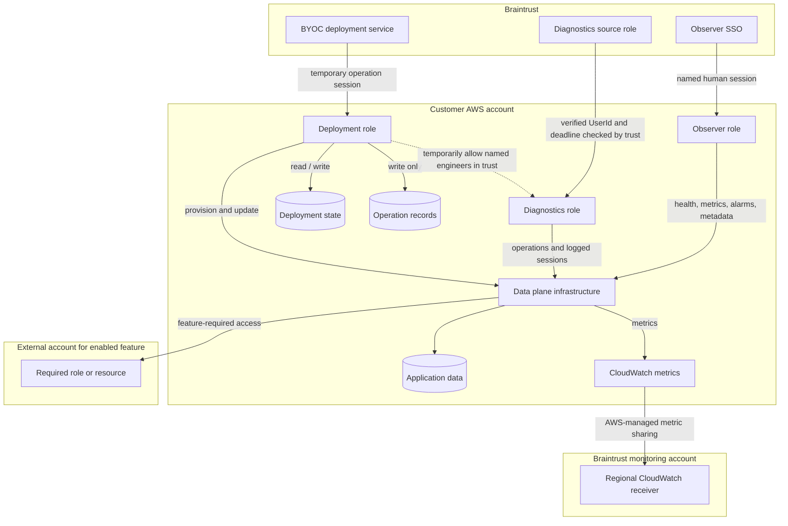

# AWS managed BYOC access model

This package describes Braintrust's standard AWS roles and customer controls
for managed BYOC. It is a security and architecture reference. Installation uses
the customer-specific CloudFormation package supplied by Braintrust.

Braintrust operates the data plane; the customer owns the AWS account,
bootstrap, state, and audit destinations. The account must be dedicated to
Braintrust infrastructure. It may contain multiple data planes, and each data
plane may serve multiple teams. Unrelated workloads belong in other accounts.

## Start here

| To review | Read |
| --- | --- |
| Role capabilities and trust limits | This page |
| Policy attachments, IAM delegation, names, and inputs | [Policy guide](policies/README.md) |
| Principals, session attribution, and trust | [Trust guide](trust-policies/README.md) |
| Organization controls | [Guardrail guide](guardrails/README.md) |
| Temporary operational access | [Diagnostics guide](diagnostics.md) |
| Scheduler and cross-account metric sharing | [Service permissions](policies/README.md#scheduler-and-metric-sharing) |
| Audit collection and detections | [Monitoring guide](guardrails/cloudtrail-alerting.md) |

## From review to deployment

1. Review this access model and the [organization safeguards](guardrails/README.md).
   Confirm service quotas support the planned deployment and upgrade capacity.
2. Braintrust generates a package for your account and Region: a CloudFormation
   template, `parameters.json`, and instructions. CloudFormation creates the
   roles, runtime boundary, state and operation-log buckets, and Diagnostics
   session document and CloudWatch log group. Names and IAM paths are filled in
   automatically. You choose whether Diagnostics activation is permitted.
3. Apply that package using your own AWS credentials and return its stack outputs
   to Braintrust for registration and verification.
4. Braintrust deploys and operates the data plane using a reviewed Terraform
   module version and the registered Deployment role.

Upgrading the data-plane module does not update the bootstrap's permissions.
Permission changes require customer review and a CloudFormation stack update.

## Roles and access

| Role | Purpose | Access |
| --- | --- | --- |
| `BraintrustDeploymentRole` | Automated infrastructure lifecycle | Privileged infrastructure management, deployment state, module secrets, and service configuration |
| `BraintrustObserverRole` | Standing human inspection | Infrastructure health, metrics, alarms, and metadata; no application content or sensitive workload configuration |
| `BraintrustDiagnosticsRole` | Temporary human operations and troubleshooting | Operational changes, application logs, sensitive configuration, and host/container sessions when activated |

Deployment and Observer trust exact designated Braintrust principals. Deployment
uses a bootstrap-specific execution role and unique External ID. Diagnostics
trust is normally closed; activation admits the exact Braintrust source role
for named engineers until a deadline. Diagnostics binds each engineer's session
identity and session name to a verified IAM Identity Center UserId. Braintrust
checks the signed directory identity when the engineer enters the source role;
AWS preserves SourceIdentity on the customer hop. See the
[trust guide](trust-policies/README.md).

### Effective access

| Capability | Deployment | Observer | Activated Diagnostics |
| --- | --- | --- | --- |
| Infrastructure health, metrics, alarms, and metadata | Yes | Yes | Yes |
| Deployment state | Exact state prefix | No | No direct grant |
| Secret values | License and prefixed module secrets | No | Through workloads; no direct Secrets Manager grant |
| Sensitive workload configuration | Yes | No | Yes |
| Application S3 objects or database rows | No direct content grant beyond state/artifacts | No | Through workload access |
| CloudWatch application log events | No direct grant | No | Matching application groups |
| Other service content | EC2 console output, RDS logs, and SQS messages under broad lifecycle grants | No | Through permitted configuration, logs, and workloads |
| Host/container sessions | No interactive grant | No | Managed Brainstore SSM shells and ECS Exec |
| Infrastructure changes | Lifecycle management | No | Scoped recovery, Auto Scaling group capacity, Lambda concurrency, legacy EventBridge rule enable/disable, and database tuning |
| ECS service autoscaling configuration | Lifecycle management | Inspect | All ECS scalable targets in the registered account and Region, across bootstrap prefixes |
| Scheduler schedule configuration, including input | Managed schedules | Managed schedules | Managed schedules |
| Scheduler changes | Create, update, delete; pass bounded execution roles | No | No |
| Cross-account CloudWatch metric sharing | Source-link management for a fixed receiver | Inspect source links | Inspect source links |
| Runtime IAM management | Prefixed resources with the required boundary and limited `PassRole` | No | No |
| Bootstrap IAM changes | Exact Diagnostics role trust during authorized activation or closure, when customer activation is enabled | No | No |
| Deletion of SCP-protected buckets, keys, and final snapshots | Blocked for the listed actions | Blocked | Blocked |

The [JSON policies](policies/README.md#role-attachment-model) are the exact
permission reference. Some lifecycle, configuration, and discovery grants apply
across the account and Regions; a resource prefix is not complete isolation
between data planes.
These capabilities assume no additional identity or resource-policy grants.
Schedule targets and inputs are readable configuration. Keep secrets and customer
payloads out of schedule input; use the workloads' normal secret stores.

Every new bootstrap authorizes metric sharing with Braintrust's designated
monitoring account. Metrics become available through a separately provisioned
regional source link. IAM restricts new links to that receiver in the data-plane
Region and permits metrics only. The monitoring module selects namespaces and
filters. This does not grant sharing of logs or traces or administration of the
receiver. See [service permissions](policies/README.md#scheduler-and-metric-sharing).

## Temporary Diagnostics

Diagnostics keeps its inspection and operational policies attached. Its trust
normally blocks role assumption. Activation temporarily replaces that trust
with the exact Braintrust source role, named engineers' verified UserIds, and
an absolute expiry. One window covers all data planes under the bootstrap; the
default is two hours. The participant list is fixed for that activation; changing
it requires closure and a new activation. Extensions require fresh checks and
recorded evidence.

An authorized Braintrust administrator activates access for themselves or other
eligible engineers. When the customer's notification requirement is enabled,
activation and extension require the administrator to confirm that the customer
has been notified. This confirmation is recorded; the workflow does not send
the notification or verify a customer response. Any additional approval process
is agreed with the customer. The AWS disable control below is independent of
this notification requirement.

Activated access can read or modify customer data and can include root access.
Application logs and workload configuration may expose data even without a shell.
The supported interactive paths are logged Session Manager shells and ECS Exec,
not SSH or port forwarding.

Expiry blocks new role assumptions through the trust's time condition. Early
closure restores closed trust; permissions remain attached. Trust updates take
time to propagate beyond policy readback. Existing credentials and connections
follow native timeouts, not active termination. See
[activation and revocation](diagnostics.md).

The customer-owned bootstrap parameter `DiagnosticsActivationEnabled` defaults
to `true`, permitting activation while access remains dormant. Setting it to
`false` installs an explicit deny on Deployment's Diagnostics trust updates and
resets Diagnostics trust to disabled. Re-enabling returns to dormant trust and
requires a fresh activation. This control does not remove Deployment's broader
privileged workload-management capabilities.

## Customer controls and responsibilities

| Braintrust | Customer |
| --- | --- |
| Provides the bootstrap and operates deployment, upgrades, and Diagnostics | Applies the bootstrap in a dedicated AWS member account |
| Configures SSM/ECS transcript collection and verifies prerequisites before Diagnostics | Enables account-level S3 Block Public Access and applies organization safeguards |
| Records operation intent, authorization, results, and trust closure | Owns CloudTrail, alerting, recovery access, and optional separate audit archival |

The [reference SCP](guardrails/README.md) protects selected account security
controls, retained resources, and snapshot sharing. It applies to customer
administrators too. Protected maintenance requires an organization administrator
to amend the policy and restore the baseline. Existing organization policies
may provide equivalent validated protections; the customer uses its normal
policy deployment process.

CloudTrail records configured AWS API activity; CloudWatch stores diagnostic
transcripts; operation records describe deployment and access workflows. These
records remain customer-owned. The [monitoring guide](guardrails/cloudtrail-alerting.md)
shows the destinations, recommended detections, and optional archive replication.

## IAM delegation and permission changes

Deployment manages runtime roles and policies under a reserved name prefix.
Created roles must carry the customer-owned runtime permissions boundary.
`PassRole` is limited to matching roles and listed AWS services. Module policies
grant each workload its actual permissions; the boundary grants none by itself.
Listed service-linked roles are an AWS-managed exception. Deployment can create
the permitted default service-linked roles as needed. See the
[approved role inventory](policies/README.md#approved-service-linked-roles).

Deployment cannot rewrite its own or Observer's bootstrap trust or any bootstrap
permissions policies. Its only bootstrap IAM change is updating the exact
Diagnostics role's trust policy during authorized activation or closure, when
the customer permits activation. An explicit deny also protects the bootstrap
CloudFormation stack. IAM scopes the trust-update permission to the role,
not to the contents of the document; Braintrust's activation workflow enforces
the named participants and deadline, with customer-visible audit evidence.
These direct restrictions do not prove that a separate privileged CloudFormation
service role or Lambda cannot be used indirectly. Review delegated service roles
and resource ownership before relying on the customer disable control.
New lifecycle services or features can require versioned bootstrap or boundary
updates controlled by the customer. Updating the data-plane module does not
automatically update those permissions.

See the [attachment map and naming rules](policies/README.md) for exact scope.

## Access outside the BYOC account

Enabled features can require access to an exact external role or resource.
For example, the Gateway may assume a role to use Bedrock in another account;
S3 export may write to a designated bucket in another account.

Each feature has documented source, destination, permissions, and configuration
requirements. Customers configure that access to use the feature; otherwise it
remains unavailable. This is a product requirement, not a separate approval for
each operation.

External integrations require matching workload permissions, runtime boundary
allowances, and destination permissions. This package does not provide a
universal cross-account perimeter. See
[external feature requirements](policies/README.md#external-feature-requirements).

## Data retention and important limits

Deprovisioning removes the infrastructure that serves the data plane. Brainstore
storage, the module-created data-plane key and alias, and a final RDS snapshot
remain for customer recovery or deletion. The bootstrap and its state, operation
records, and Diagnostics log group also remain customer-owned; retiring the
bootstrap is a separate step. A partial deployment may have no database and
therefore no final snapshot.

Understand these boundaries:

- **Privileged deployment:** automation can change workload code, runtime trust,
  and bucket/key policies. Removing direct content grants does not prove that
  Braintrust cannot reach data through workloads or resource-policy changes.
- **Sensitive state:** deployment state can contain generated credentials and
  application encryption material. Deployment can read it; human roles have no
  direct state grant.
- **Retention is not immutability:** the SCP blocks specified bucket, key, and
  snapshot deletions. It does not block object deletion or unsafe lifecycle
  expiration. Workloads and privileged diagnostic sessions can modify data.
- **Logging has limits:** Deployment can change ECS Exec logging settings, and
  a privileged shell can interfere with capture. Activation checks, monitoring,
  and customer-controlled archival reduce risk but do not guarantee a complete
  transcript of every action.
- **Expiry limits new assumptions:** existing AWS credentials and interactive
  sessions can continue beyond the window. Closing trust is not session revocation.

These are the trust boundaries of a managed service, not guarantees of complete
data isolation from its operator.
